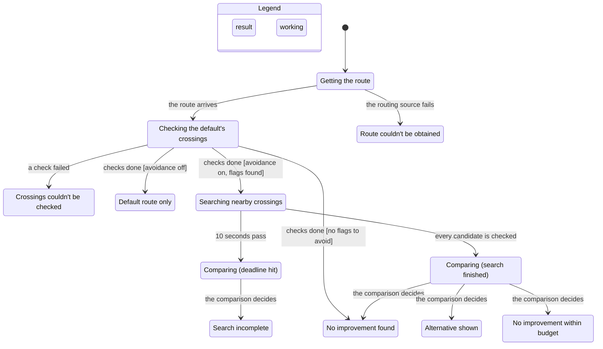
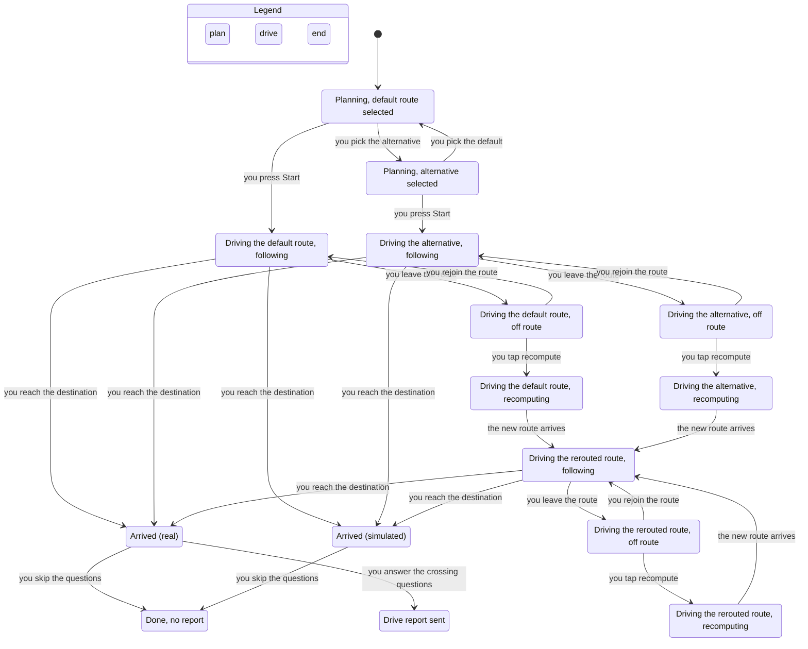

# Properties: flows and the rules they keep

Stage 3 of the method in `AGENTS.md`, built on [abstract.md](abstract.md) and
[concrete.md](concrete.md). Settled 2026-11-06. Every rule below holds in a TLA+ model checked
with TLC, and each was shown to catch a deliberately broken flow.

## Flow A: one comparison (service)

```
compare(trip, avoid, deadline = 10 s)
  [code] raw = RouteSource.route(origin, example_via, destination)
         └ unavailable → HTTP 503 "Route couldn't be obtained"; the app offers retry
  [code] default = interpret(raw)            # movements → crossings; carriageways merged;
                                             # OSM node ids by nearest junction within 3 m
  [code] records = RecordSource.snapshot(bbox(default))
         └ unavailable → every crossing check_failed; outcome check_failed, no flag count
  for each crossing on default:
    [code] rules(crossing, records) → flagged | unflagged | open questions
    [code] for each open question: Jev cache lookup by (model, evidence hash, question)
    [Jev]  cache misses, batched one request per route
           given: the crossing's records, its approach bearing and kind
           yes: answer at probability ≥ 0.9 AND the gate has passed for this model
           no:  anything else → unknown; the answer is kept as a lead
           └ Jev unavailable → that crossing check_failed
  any default crossing check_failed → outcome check_failed, no flag count
  (avoidance off: the app calls only /default and shows the default alone)
  default has no flags              → outcome no_improvement
  [code] search: for each crossing of the same main street within 3 blocks
           route through it; drop it unless the geometry crosses there in the intended direction
           assess the crossings it introduces (shared crossings come from the cache)
           deadline reached → stop; search_complete = false
  [code] keep candidates where known + unknown < default's known flags
           AND added time ≤ min(20% of default ETA, 5 min)
  [code] rank by (known + unknown, known, ETA); take the first
  [code] outcome: improvement | over_budget | no_improvement | incomplete
           improvement with search_complete = false reads "best found within this search";
           incomplete only when nothing was found in time
  [code] explanation from templates
```

## Flow B: corridor pre-run and Jev gate (offline)

```
  [code] enumerate every crossing in the corridor: main-street junction × approach × kind
  [code] rules → settled set S, open set O
  [Jev]  ask S the same questions with the same records
         yes = Jev's answer at ≥ 0.9 equals the rule's answer; no = it disagrees
  [code] gate passes iff Jev never confidently disagrees on S → stored with the model version
  [Jev]  ask O → write the answers to the cache
  [code] one log line: the counts, and pass or fail
```

Flow B is a pipeline with no states that matter, so it has no model. Its rule (9) is checked in
Flow A's model through the gate value.

## Flow C: the app

```
  [user] choose a trip  → [code] GET default, draw it with markers
  [user] avoidance on   → [code] POST comparison, draw the alternative and markers
  [user] choose a route; press Start (while parked)
  [code] Follower(route, feed) → following | offRoute | arrived
         offRoute → banner → [user] tap → [code] reroute: unassessed, labeled rerouted, no markers
  arrived:  real feed      → [user] one tap per marked crossing → [code] POST drive report
            simulated feed → nothing
```

## The rules

The owner's rules, word for word:

1. An unknown is never counted as unflagged.
2. A failed check never shows a flag count.
3. An alternative is shown only if it has fewer flags than the default even when all its unknowns are flags.
4. A shown alternative never exceeds its time budget.
5. Every crossing on a shown alternative has been assessed, including the ones it introduces.
6. A shown alternative actually crosses where it was meant to, in the intended direction.
7. An incomplete search is never reported as "no improvement".
8. A lead never changes a crossing's status.
9. Jev's answers change a status only after Jev has passed its gate.
10. The same evidence and preference always give the same result.
11. A rerouted route never shows crossing markers or claims.
12. A simulated drive never sends a drive report.
13. The app never changes the route without the driver's tap.
14. The app never says a route is safe.

| Rule | Checked by |
|---|---|
| 1–9 | TLC, `models/Compare.tla` |
| 11–13 | TLC, `models/Drive.tla` |
| 10 | Property test: the same fixtures and preference twice give identical responses |
| 14 | Test over every explanation template and app string |

## What TLC found

- **Flow A:** 2,658 states; rules 1–9 and no-deadlock hold. **Flow C:** 58 states; rules 11–13
  and no-deadlock hold.
- Each rule was checked against a deliberately broken flow, and each break was caught by its rule:
  ignoring unknowns in the improvement test (rule 3), treating the deadline as a finished search
  (rule 7), counting Jev without the gate (rules 1, 8, 9), showing a count after a failed check
  (rule 2), ignoring the budget (rule 4), keeping markers after reroute (rule 11), sending a report
  from a simulated drive (rule 12), rerouting without a tap (rule 13).
- The first draft of the model had two rules that checked the flow against itself: rule 3 reused
  the flow's own flag arithmetic and rule 7 its own "search complete" flag, so breaking the flow
  broke the rule the same way. Both now use independent values. Any test for these two rules must
  do the same: compute the expected count, and observe the deadline, outside the code under test.

## Charts

The comparison chart is drawn from a reduced model (`ComparePic.tla`: gate passed, one candidate,
three kinds of evidence) because the full model exceeds the chart budget; the full model is the
one checked. The driving chart hides only the "nothing more happens" step at each end state.





## What the models leave out

- Geometry, distances and ETA values: budget and placement are yes/no choices made by the model.
- Ranking among several improving candidates beyond the worst-case count (ETA ties).
- Partial crossings on the default route that the alternative shares; every candidate avoids the
  default's one crossing.
- Concurrency inside a comparison, retries, and cache freshness.
- Simulated playback controls (start, pause, restart) inside a drive.
- Rules 10 and 14, which are tests, not states.

## Rerun the check

```bash
export TLA2TOOLS=/path/to/tla2tools.jar JAVA=java   # tla2tools 1.7.4, sha256 936a2620…e050e88
SC=~/.claude/plugins/cache/cursor-plugins/pstack/0.15.36/skills/statechart/scripts/statechart
cd docs/design/models
$SC Compare.tla --config Compare.cfg --view compare-view.mjs --out /tmp/sc-compare
$SC ComparePic.tla --config Compare.cfg --view compare-view.mjs --out /tmp/sc-compare-chart
$SC Drive.tla --config Drive.cfg --view drive-view.mjs --out /tmp/sc-drive
```
